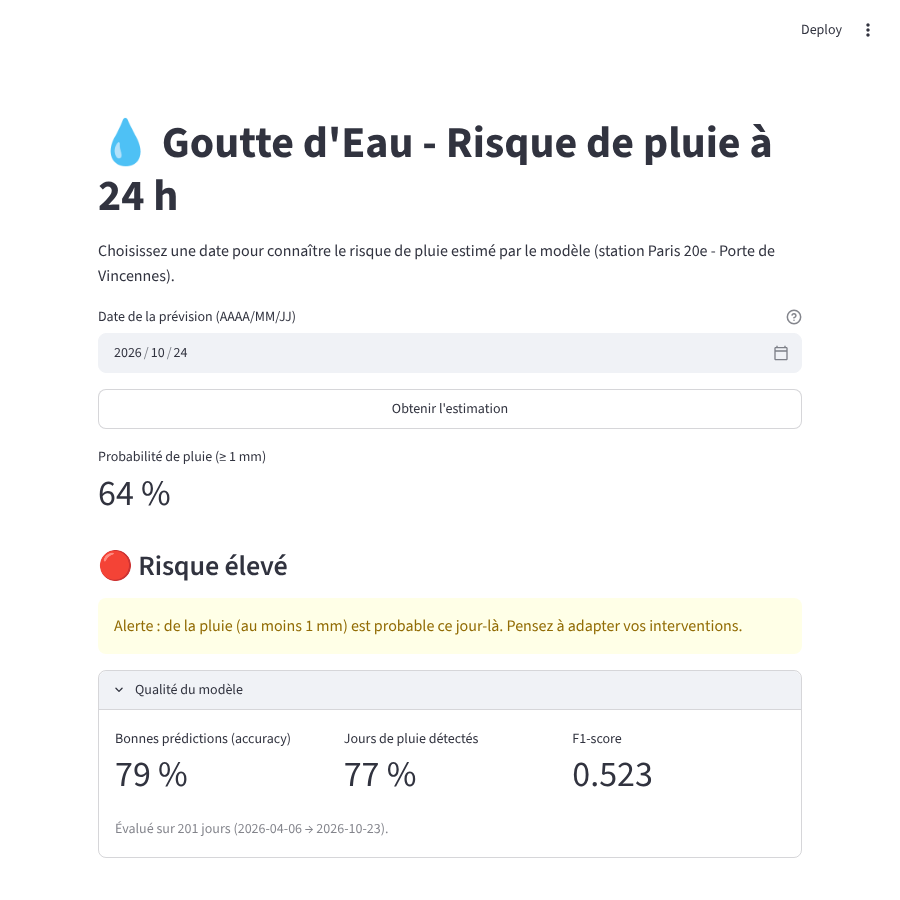
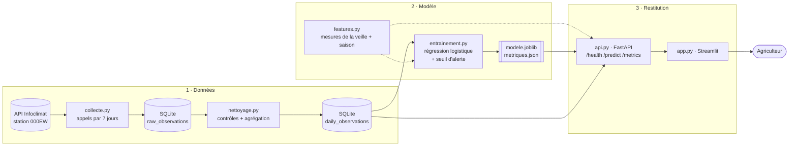

# 💧 Projet Goutte d'Eau – MVP de prévision du risque de pluie

Prototype réalisé dans le cadre du Mastère Transformation Digitale, Data et IA (Bloc 2).
**Auteur** : Yacine Abdeladim

Le MVP prévoit, pour une date donnée, le **risque qu'il tombe au moins 1 mm de pluie** à Paris, à partir des
mesures de la veille. Il couvre toute la chaîne demandée : collecte depuis une API, stockage en base,
modèle de machine learning, API de restitution et interface de démonstration.

- **Station** : Paris 20e – Porte de Vincennes (réseau Infoclimat, identifiant `000EW`), cohérente avec le pilote du département 75 défini au Bloc 1
- **Données** : 143 923 mesures, de janvier 2024 à octobre 2026, une toutes les 10 minutes
- **Modèle** : régression logistique (léger, explicable, sans GPU)
- **Documentation interactive de l'API** : http://127.0.0.1:8000/docs (Swagger, une fois l'API lancée)



---

## Architecture



Les diagrammes d'architecture et de composants détaillés sont dans [`docs/`](docs/).

| Fichier | Rôle |
|---|---|
| `choisir_station.py` | Compare 5 stations parisiennes pour choisir celle où la pluie est la mieux mesurée |
| `test_api.py` | Vérifie que la clé API donne bien accès à la station |
| `collecte.py` | Récupère les mesures par tranches de 7 jours (limite de l'API) et les stocke dans `raw_observations` |
| `nettoyage.py` | Supprime doublons et valeurs aberrantes, agrège par jour dans `daily_observations` |
| `features.py` | Calcule les variables du modèle, partagé par l'entraînement et l'API pour garantir le même calcul |
| `entrainement.py` | Entraîne le modèle, choisit le seuil d'alerte, évalue et enregistre |
| `api.py` | API REST FastAPI |
| `app.py` | Interface de démonstration Streamlit |
| `analyse.ipynb` | Notebook : exploration, qualité des données, analyses univariées et bivariées, modèle, évaluation |

## Installation

```bash
git clone https://github.com/abdeladimyacine-create/goutte_eau_mvp.git
cd goutte_eau_mvp
python -m venv venv
venv\Scripts\activate          # Windows  (Mac/Linux : source venv/bin/activate)
pip install -r requirements.txt
```

La base de données (`data/meteo.db`) et le modèle entraîné (`model/`) sont fournis : **l'API et l'interface
fonctionnent directement, sans clé**.

Pour relancer la collecte, il faut une clé personnelle Infoclimat (voir plus bas), à placer dans un fichier `.env`
sur le modèle de `.env.example`. Ce fichier n'est jamais publié (`.gitignore`).

## Lancement

```bash
# Démonstration (données et modèle déjà fournis)
uvicorn api:app --reload        # API      -> http://127.0.0.1:8000/docs
streamlit run app.py            # interface, dans un 2e terminal

# Chaîne complète (avec une clé Infoclimat)
python test_api.py              # vérifie la clé et l'accès à la station
python collecte.py              # collecte (environ 3 minutes)
python nettoyage.py             # nettoyage et agrégation journalière
python entrainement.py          # entraînement, seuil d'alerte, indicateurs
```

## API

| Méthode | Route | Rôle | Exemple de réponse |
|---|---|---|---|
| GET | `/health` | État du service et dernière date prévisible | `{"statut": "ok", "derniere_date_prevue": "2026-10-24"}` |
| GET | `/predict?date_cible=2026-10-24` | Risque de pluie pour une date | `{"probabilite_pluie": 0.644, "risque": "élevé", "alerte": true}` |
| GET | `/metrics` | Indicateurs qualité du modèle | accuracy, précision, rappel, F1, ROC-AUC, matrice de confusion |

## Choix du modèle

- **Cible** : jour de pluie si cumul ≥ 1 mm (définition Météo-France d'un « jour de pluie »).
- **Variables** : mesures de la veille (températures, pression, humidité, vent, pluie), tendance de pression, saison.
  Le jour J est prédit avec les données de J-1 : c'est une vraie prévision à 24 h, et l'API n'a besoin que d'une date.
- **Modèle** : régression logistique avec standardisation et rééquilibrage des classes. Entraînement en moins d'une seconde, sans deep learning.
- **Seuil d'alerte** : 0,40, choisi uniquement sur l'entraînement (validation chronologique), pour mieux détecter les pluies.
- **Évaluation** : découpage chronologique (passé pour apprendre, période la plus récente pour tester) et comparaison
  avec une règle simple de persistance (« il pleuvra demain s'il a plu aujourd'hui »).

## Résultats (données réelles)

1 011 jours nettoyés, dont 27,8 % de jours de pluie. Test sur 201 jours (avril à octobre 2026) :

| Indicateur | Modèle | Référence (persistance) |
|---|---|---|
| Rappel (jours de pluie détectés) | **0,77** | 0,40 |
| F1-score | **0,52** | 0,40 |
| ROC-AUC | **0,84** | – |
| Accuracy | 0,79 | 0,82 |
| Précision | 0,40 | 0,40 |

Le modèle détecte presque deux fois plus de pluies que la règle de référence, au prix de fausses alertes :
pour un agriculteur, rater une pluie coûte plus cher qu'une alerte inutile. Détails et graphiques : `analyse.ipynb` et `figures/`.

## Démarche et difficultés rencontrées

- **Clé API liée à l'adresse IP** : la clé Infoclimat ne fonctionne que depuis la connexion déclarée lors de sa création ;
  la collecte doit donc être lancée depuis ce poste.
- **Station refusée** : la station officielle Paris-Montsouris (07156) n'est pas ouverte à l'API (« Station not allowed »).
- **Station sans historique de pluie** : la première station testée (Paris 5e – Jussieu, 000BV) ne mesure la pluie que depuis
  février 2026 ; le modèle n'avait que 154 jours pour apprendre. `choisir_station.py` a permis de comparer 5 stations
  et de retenir 000EW, où la pluie est mesurée 99 % du temps depuis 2024.
- **Pluie comptée plusieurs fois** : la station envoie une mesure toutes les 10 minutes, mais `pluie_1h` est le cumul de la
  dernière heure, répété à chaque mesure. Le nettoyage garde la dernière mesure de chaque heure, sinon la pluie était multipliée par 6.
- **Variable absente** : les rafales ne sont pas mesurées par la station ; le modèle les ignore automatiquement.

## Éco-conception

Une seule station, 7 variables conservées sur une quinzaine, agrégation journalière (142 fois moins de lignes),
modèle léger entraîné une seule fois puis rechargé par l'API, collecte espacée pour respecter le service bénévole d'Infoclimat.

## Sécurité

La clé API reste dans `.env`, exclu du dépôt par `.gitignore`. L'API est en lecture seule et FastAPI valide le format de la date.

## Données

Données issues de l'API Open Data d'Infoclimat (licence CC BY), utilisées pour un usage non commercial.
